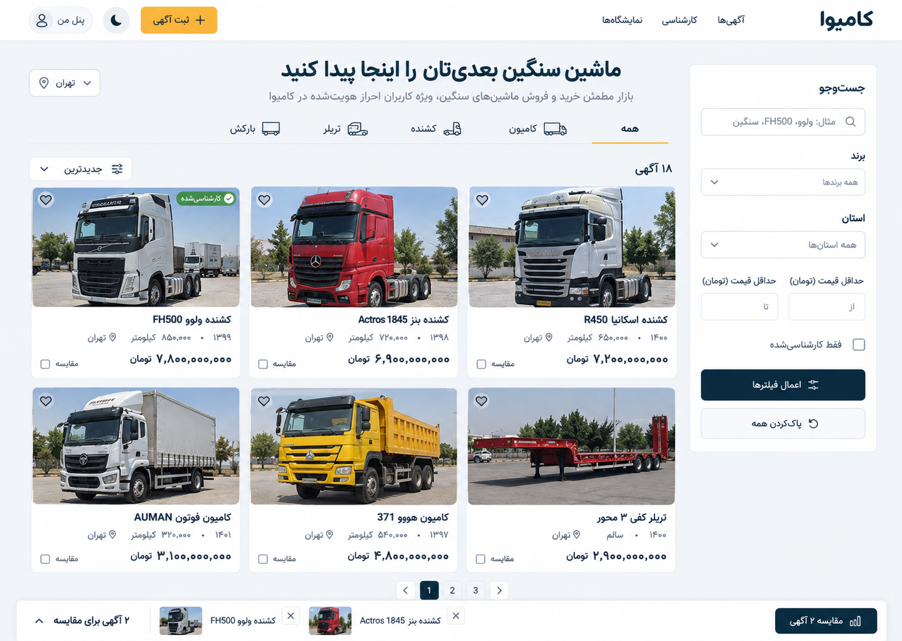

# Kamiva — Heavy-Vehicle Marketplace (Persian, RTL)

**Kamiva (کامیوا)** is a full-stack marketplace web app for buying, selling and appraising heavy vehicles — trucks, tractor units, trailers and carriers. It is built for Persian-speaking users with a right-to-left interface, Solar Hijri (Jalali) dates and light/dark themes.

> Portfolio project. Payments, SMS and email run through clearly labelled **test providers** — no real money or messages are sent.



## Highlights

- **Three paid membership plans** — *Pro* (dealerships), *Plus* (individual professionals) and *Buyer* — each with 30-day subscriptions, listing quotas per category and renewal flows.
- **Listings with moderation** — up to 5 photos (Pro: plus 2 short videos), price history, sold/paused/archived lifecycle, and a review queue where an approved version stays live while edits await approval.
- **Market-position insight** — compares an asking price with similar active offers (same category/brand/model, ±1 year, ±20 % mileage) using quartiles, and never presents offer prices as sale prices.
- **Expert appraisal workflow** — paid inspection requests, per-province experts assigned by staff, reports with final approval, and an expert wallet with IBAN withdrawal requests.
- **Seller pages** — moderated public profiles with contact channels the seller chooses (phone, WhatsApp, Telegram, email).
- **Back office** — identity verification with document review, staff roles with granular per-section permissions, user search by internal code, online/activity tracking, support tickets and a full audit log.
- **Buyer tools** — search and filters, favourites, side-by-side comparison of up to three vehicles.

## Security design

- **PostgreSQL row-level security (RLS)** on all private tables as defence in depth: every connection carries the signed-in user's context and fails closed when no context is set.
- Object-level permission checks in services and views; ownership, role, price paid and approval flags are never trusted from the client.
- Transaction-safe quotas and payment idempotency (row locks, replay-safe callbacks), covered by concurrency tests on PostgreSQL.
- CAPTCHA and rate limiting on sign-in, password complexity rules, optional TOTP two-factor authentication, session invalidation on credential changes, and automatic 30-day rotation of the main administrator's credentials.
- Private identity documents and appraisal reports are served only through permission-checked views, never as public media; uploaded images are validated and stripped of metadata.
- Sensitive outbox payloads are encrypted at rest; audit records exclude secrets.
- Encrypted (AES-GCM) backups with automatic restore verification into a disposable database (`deploy/backup.py`).
- Strict security headers (CSP, HSTS, frame denial) and an nginx front end that blocks private paths.

## Tech stack

| Layer | Technology |
|---|---|
| Backend | Python 3.14, Django 5.2 LTS |
| Database | PostgreSQL 18 (row-level security), SQLite for quick local runs |
| Frontend | Django templates, HTMX, hand-written CSS, Vazirmatn font, RTL, light/dark themes |
| Serving | Gunicorn behind nginx, systemd services and timers |
| Other | Jalali calendar formatting, TOTP (PyOTP), Pillow image processing, `cryptography` |

No front-end framework and no external AI services are used.

## Quality

- **189 automated tests** covering all roles, subscription expiry, verification, payments (success/failure/delay/replay), moderation, quota boundaries under concurrency, private files, tickets, admin credential rotation, MFA, row-level security and backups.
- **Load benchmark** on a 1 vCPU / 1 GB server: 500 active users browsing at a typical pace (one page every ~30 s) were served with no errors, median response ≈ 0.13 s and p95 ≈ 0.5 s.

## Run locally

```bash
python -m venv .venv
source .venv/bin/activate          # Windows: .venv\Scripts\activate
pip install -r requirements.txt
cp .env.example .env               # then set DJANGO_SECRET_KEY and KAMIWA_OUTBOX_KEY
python manage.py migrate
python manage.py seed_demo         # optional demo data; generated passwords are written to artifacts/private/
python manage.py runserver
```

`.env.example` points `DATABASE_URL` at PostgreSQL (required for row-level security and the concurrency tests). Remove that line to run quickly on SQLite instead.

```bash
python manage.py test market.tests
```

## Project structure

```
kamiwa/      Django project settings and URLs
market/      models, transactional services, views, forms, RLS, providers, jobs, tests
templates/   Django templates (RTL)
static/      CSS, JS, HTMX, Vazirmatn font, decorative images
design/      design system and page inventory (DESIGN.md) with concept images
docs/        product acceptance contract
deploy/      systemd units, nginx template, backup tool
```

## Credits

Decorative vehicle photos are public-domain / CC0 images from Wikimedia Commons. The Vazirmatn font is licensed under the SIL Open Font License (`static/kamiwa/fonts/OFL.txt`).

## License

© 2026 Ali Khazaei. All rights reserved. The source is published for portfolio review; please contact the author before reusing it.

---

## خلاصه فارسی

**کامیوا** یک بازار آنلاین تخصصی برای خرید، فروش و کارشناسی ماشین‌آلات سنگین (کامیون، کشنده، تریلر و بارکش) است؛ با رابط کاربری فارسی و راست‌به‌چپ، تاریخ شمسی و حالت روز و شب.

- سه نوع اشتراک پولی: پرو (نمایشگاه‌ها)، پلاس (فروشندگان حرفه‌ای) و خریدار
- ثبت و بررسی آگهی، تاریخچه قیمت، مقایسه قیمت با بازار و صفحه اختصاصی فروشنده
- درخواست کارشناسی، تخصیص کارشناس استانی، گزارش نهایی و کیف پول کارشناسان
- پنل مدیریت با احراز هویت، دسترسی‌های تفکیک‌شده، تیکت پشتیبانی و ثبت رویدادها
- امنیت: امنیت سطری PostgreSQL، کنترل دسترسی در سرویس‌ها، کد امنیتی تصویری، ورود دومرحله‌ای، پشتیبان رمزگذاری‌شده
- فناوری: Python 3.14، Django 5.2، PostgreSQL 18 و HTMX
- ۱۸۹ آزمون خودکار و آزمون بار برای ۵۰۰ کاربر فعال

پرداخت، پیامک و ایمیل در این نسخه آزمایشی هستند و پول یا پیام واقعی جابه‌جا نمی‌شود.

